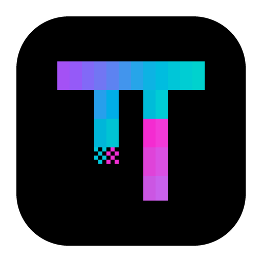

<div align="center">



# OMP Desktop

**A desktop app for the [Oh My Pi](https://github.com/can1357/oh-my-pi) coding agent.**

Projects, sessions, approvals, and reviews in one window, with the OMP runtime built in.

[](https://github.com/MisterBowie/omp-desktop/releases/latest)
[](https://github.com/MisterBowie/omp-desktop/releases)
[](app/LICENSE)


**[Download](https://github.com/MisterBowie/omp-desktop/releases/latest)** ·
[Features](#features) ·
[Install](#install) ·
[Build from source](#build-from-source) ·
[简体中文](README.zh-CN.md)

</div>

OMP Desktop runs the Oh My Pi (OMP) agent in a desktop workspace. The app ships
its own OMP runtime and talks to it over OMP's structured RPC protocol, so
messages, tool calls, approvals, and subagents keep their structure instead of
being scraped from a terminal. The interface is derived from
[PI-Desktop](https://github.com/vastsa/PI-Desktop).

> **Status:** 0.1.x release line. Builds are not code-signed yet; see [Install](#install).

## Features

### Work in projects

- Sessions are grouped by project in the sidebar. A session stays bound to the
  project, engine, and runtime version it was created with, so switching
  projects never moves a running session.
- Sessions persist across restarts. Reopening one reads OMP's native history
  without running any tool again.
- Start an isolated session in its own local Git worktree, then preview a merge
  back into the project or sync new project commits into it.
- Reference files with `@`, run slash commands and `/skill:` commands, and paste
  or attach images.

### Stay in control

- Choose a permission mode per session: **Ask every time**, **Accept edits**, or
  **Auto**. Approval is enforced before a tool runs, so a denied write never
  touches the file.
- Approve once, approve for the whole chat, or deny. Requests left unanswered
  are denied automatically.
- Switch between **Agent**, **Plan**, and **Goal** modes.
- Steer a running turn or queue follow-ups. **Stop** ends the turn together with
  its background tasks and child processes.

### See what the agent did

- Follow subagents started by OMP's `task` tool, each with its own progress and
  result.
- OMP's Todo list stays visible above the composer.
- The **Review** tab lists the files OMP edited or wrote, and a
  **Changes this turn** card under each finished reply links to them.
- See generation speed, per-turn token usage, and a context ring that shows how
  much of the model's context is in use.
- Get language-server diagnostics after Write and Edit when a matching server is
  installed for the project.
- Browse project files and preview pages in the work panel's built-in browser.

### Extend it

- Install plugins from Claude Code–compatible marketplaces through OMP. Their
  skills, commands, subagents, rules, MCP servers, and hooks load into OMP chats.
- Manage skills, MCP servers, and subagents. Global ones live in `~/.agents`,
  which is shared on purpose with other tools that read it.
- Turn on automatic memory saving and recall for each project or worktree (both
  are off by default).
- Set global instructions that apply to every OMP chat.

### Use your own models

- Bring your own API key. Presets cover OpenAI, Anthropic, Google Gemini,
  DeepSeek, OpenRouter, Mistral, Qwen, Kimi, and more. Any other endpoint,
  including a local model server, works if it speaks the OpenAI Chat
  Completions, OpenAI Responses, Anthropic Messages, or Google Generative AI
  format.
- Switch models and reasoning levels inside a session. Provider-published
  context and output limits are used unless you set your own.
- Send model traffic through a custom proxy, the system proxy, or a direct
  connection.

The interface is available in English, Simplified Chinese, Traditional Chinese,
German, Spanish, French, Korean, and Turkish.

## Install

Download the package for your platform from the
[latest release](https://github.com/MisterBowie/omp-desktop/releases/latest).

| Platform | Architecture | Package |
| --- | --- | --- |
| macOS | Apple Silicon | `OMP-Desktop-<version>-arm64.dmg` or `-arm64-mac.zip` |
| macOS | Intel | `OMP-Desktop-<version>-x64.dmg` or `-x64-mac.zip` |
| Windows | x64 | `OMP-Desktop-Setup-<version>.exe` (installer) or `OMP-Desktop-Portable-<version>.exe` |
| Linux | x64 | `OMP-Desktop-<version>-x86_64.AppImage`, `.deb`, or `.rpm` |

Each release publishes `SHA256SUMS.txt` for checking downloads.

**macOS.** Builds are not signed or notarized yet. If macOS refuses to open the
app, allow it under **System Settings → Privacy & Security**. If macOS reports
that the app is damaged, move it to `/Applications` and run:

```sh
xattr -r -d com.apple.quarantine "/Applications/OMP Desktop.app"
```

The ZIP package includes the same steps in `OMP-Desktop-macOS-opening-help.txt`
and a helper, `OMP-Desktop-macOS-open.command`. Only do this for a package
downloaded from this repository's releases.

**Windows.** The agent's shell tool uses Git for Windows (Git Bash).

**Linux.** Packages need glibc 2.35 or newer (Ubuntu 22.04, Debian 12,
Fedora 36, or later).

### Updates

OMP Desktop checks this repository's stable releases. The Windows installer and
the Linux AppImage download and install updates inside the app. On macOS, and
for the Windows portable, `.deb`, and `.rpm` packages, the app announces the new
version and opens its download page.

## Your data

- OMP Desktop keeps its data in `~/.omp-desktop`, separate from PI-Desktop and
  the OMP command line. It does not import or change their sessions or settings.
- API keys are stored encrypted in that folder, in files only your user account
  can read.
- There is no account and no analytics. Crash dumps stay on your computer.
- Model requests go to the provider you configure, through the proxy setting you
  choose. Update checks contact GitHub.

To back up, quit the app and copy the whole `~/.omp-desktop` folder, keeping
file permissions. On macOS, also copy `~/Library/Application Support/OMP Desktop`.

## Known limitations

- Builds are not code-signed, so macOS updates are installed by hand.
- Sessions cannot be branched yet.
- Provider OAuth sign-in is not available; use API keys.
- Sessions from PI-Desktop or the OMP command line are not imported.

## Build from source

Requirements:

- Node.js 24 (22.19 or newer) and pnpm 10
- Rust stable, for the desktop host (`host-core`)
- To build the bundled OMP runtime: Bun 1.4 or newer, Rust
  `nightly-2026-08-12`, and a checkout of
  [MisterBowie/oh-my-pi](https://github.com/MisterBowie/oh-my-pi) at the commit
  pinned in [`app/patches/oh-my-pi/manifest.json`](app/patches/oh-my-pi/manifest.json)

```bash
git clone --recurse-submodules https://github.com/MisterBowie/omp-desktop.git
cd omp-desktop/app
pnpm install
pnpm build:js
cargo build -p host-core --locked
```

Run the checks:

```bash
pnpm typecheck
pnpm lint
pnpm test
```

Build an unsigned package for the current platform:

```bash
OMP_SIDECAR_SOURCE=/path/to/oh-my-pi pnpm --filter @pi-desktop/desktop run dist:mac   # or dist:win, dist:linux
```

Packaging refuses an OMP checkout that does not match the manifest. Published
releases are built by GitHub Actions ([`release.yml`](.github/workflows/release.yml));
the steps are in the [release runbook](app/docs/spec/06-delivery/06-release-runbook.md).
More about the source tree is in [`app/README.md`](app/README.md).

## Repository layout

| Path | Contents |
| --- | --- |
| `app/` | Product source: Electron app, Rust host, OMP adapter, packages, specs, and ADRs |
| `app/patches/oh-my-pi/` | Manifest of the controlled OMP fork that the app bundles |
| `docs/` | Plans, task board, and validation evidence for each release (in Chinese) |
| `upstream/pi-desktop`, `upstream/oh-my-pi` | Pinned reference submodules; product code is not changed there |
| `HANDOFF.md` | Current status and next steps |
| `AGENTS.md` | Rules for coding agents working in this repository |

## Contributing

Bug reports and feature requests are welcome in
[Issues](https://github.com/MisterBowie/omp-desktop/issues). Read
[CONTRIBUTING.md](app/CONTRIBUTING.md) before opening a pull request. Report
security problems privately as described in [SECURITY.md](app/SECURITY.md).

## Acknowledgements

- [PI-Desktop](https://github.com/vastsa/PI-Desktop): the desktop app OMP
  Desktop is derived from.
- [Oh My Pi](https://github.com/can1357/oh-my-pi): the agent runtime bundled
  with the app.
- [pi](https://github.com/badlogic/pi-mono): the agent toolkit both projects
  build on.

OMP Desktop is an independent project. It is not affiliated with or endorsed by
these projects.

## License

The desktop app in `app/` is licensed under the
[GNU Lesser General Public License v3.0](app/LICENSE), inherited from
PI-Desktop, and keeps its copyright notices. The bundled OMP runtime is under
the [MIT License](https://github.com/can1357/oh-my-pi/blob/main/LICENSE).
Third-party notices ship inside every package.
