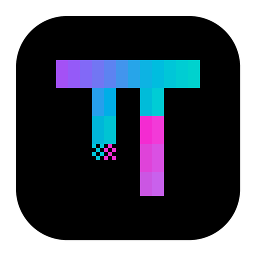
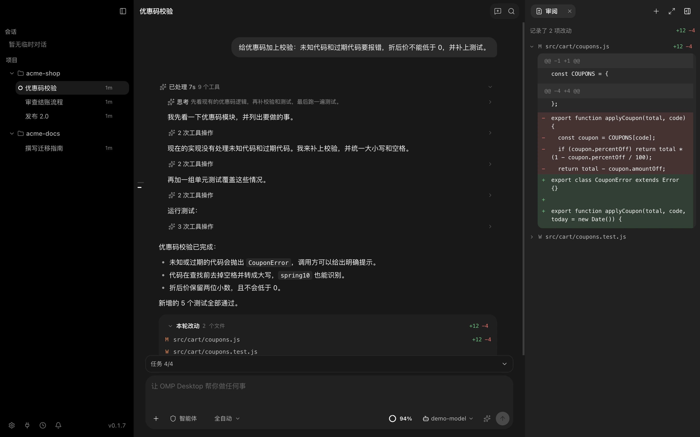
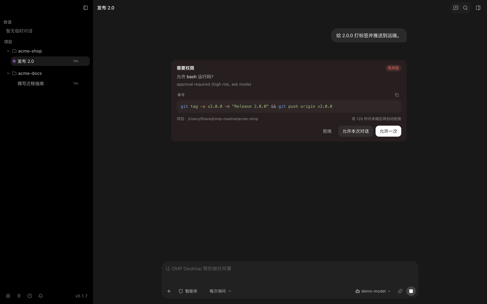
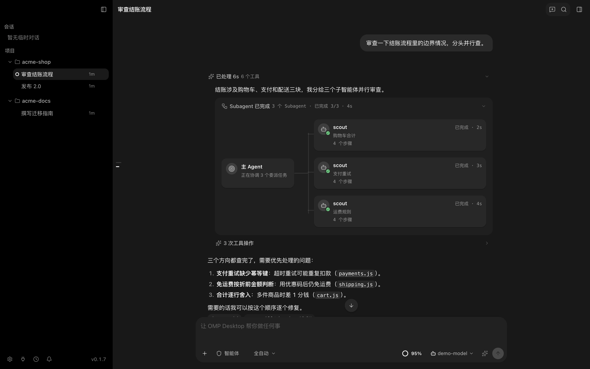
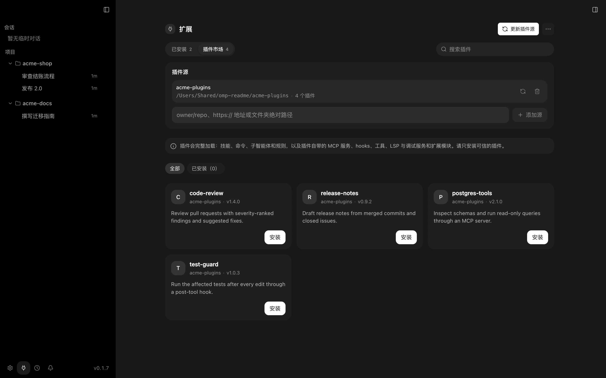

<div align="center">



# OMP Desktop

**[Oh My Pi](https://github.com/can1357/oh-my-pi) 编码智能体的桌面应用。**

项目、会话、工具审批和改动审阅集中在一个窗口里，内置 OMP 运行时。

[](https://github.com/MisterBowie/omp-desktop/releases/latest)
[](https://github.com/MisterBowie/omp-desktop/releases)
[](app/LICENSE)


**[下载](https://github.com/MisterBowie/omp-desktop/releases/latest)** ·
[功能](#功能) ·
[安装](#安装) ·
[从源码构建](#从源码构建) ·
[English](README.md)

<br />



</div>

OMP Desktop 在桌面工作区中运行 Oh My Pi（OMP）智能体。应用自带 OMP 运行时，通过 OMP
的结构化 RPC 协议与之通信：消息、工具调用、审批和子智能体都保留原有结构，而不是从终端
输出中截取文本。界面源自 [PI-Desktop](https://github.com/vastsa/PI-Desktop)。

> **状态：** 0.1.x 版本线。安装包暂未代码签名，见[安装](#安装)。

## 功能

### 以项目组织工作

- 侧栏按项目分组显示会话。会话始终绑定创建时的项目、引擎和运行时版本，切换项目不会改变
  正在运行的会话。
- 会话在重启后保留。重新打开时读取 OMP 原生历史，不会再次执行任何工具。
- 可在独立的本地 Git worktree 中创建隔离会话，之后预览合并回项目，或把项目的新提交同步进来。
- 用 `@` 引用文件，使用斜杠命令和 `/skill:` 命令，粘贴或附加图片。

### 由你掌控

- 每个会话可选择权限模式：**每次询问**、**允许编辑**或**全自动**。审批在工具执行前生效，
  被拒绝的写入不会改动文件。
- 可以允许一次、允许本次对话或拒绝；超时未响应的请求会被自动拒绝。
- 可在**智能体**、**规划**和**目标**模式之间切换。
- 运行中可以插话或排队跟进。**停止**会同时结束该回合的后台任务和子进程。



### 看清智能体做了什么

- 跟踪 OMP `task` 工具启动的子智能体，各自显示进度和结果。
- OMP 的 Todo 清单显示在输入框上方。
- “审阅”标签列出 OMP 编辑或写入的文件，每条完成的回复下方有“本轮改动”卡片可直接跳转。
- 显示生成速度、每轮 token 用量，以及表示模型上下文占用的圆环。
- 项目装有对应的语言服务器时，Write 和 Edit 之后会返回 LSP 诊断。
- 在工作面板中浏览项目文件，并用内置浏览器预览页面。



### 扩展

- 通过 OMP 安装 Claude Code 兼容市场中的插件，其技能、命令、子智能体、规则、MCP 服务器和
  hooks 会加载到 OMP 会话中。
- 管理技能、MCP 服务器和子智能体。全局配置位于 `~/.agents`，有意与其他读取该目录的工具共享。
- 可按项目或 worktree 开启自动记忆的保存与读取（默认均关闭）。
- 设置作用于所有 OMP 会话的全局指令。



### 使用你自己的模型

- 使用自己的 API 密钥。内置 OpenAI、Anthropic、Google Gemini、DeepSeek、OpenRouter、Mistral、
  通义千问、Kimi 等预设；其他端点（包括本地模型服务）只要兼容 OpenAI Chat Completions、
  OpenAI Responses、Anthropic Messages 或 Google Generative AI 格式即可接入。
- 在会话中切换模型和思考等级。默认使用服务商公布的上下文和输出上限，也可以手动设置。
- 模型请求可走自定义代理、系统代理或直连。

界面支持英语、简体中文、繁体中文、德语、西班牙语、法语、韩语和土耳其语。

<sub>截图为 OMP Desktop 0.1.7 运行真实 OMP 会话的画面，模型由本机脚本模拟，由
[`app/scripts/readme-screenshots.mjs`](app/scripts/readme-screenshots.mjs) 生成。</sub>

## 安装

从[最新版本](https://github.com/MisterBowie/omp-desktop/releases/latest)下载对应平台的安装包。

| 平台 | 架构 | 安装包 |
| --- | --- | --- |
| macOS | Apple Silicon | `OMP-Desktop-<版本>-arm64.dmg` 或 `-arm64-mac.zip` |
| macOS | Intel | `OMP-Desktop-<版本>-x64.dmg` 或 `-x64-mac.zip` |
| Windows | x64 | `OMP-Desktop-Setup-<版本>.exe`（安装版）或 `OMP-Desktop-Portable-<版本>.exe` |
| Linux | x64 | `OMP-Desktop-<版本>-x86_64.AppImage`、`.deb` 或 `.rpm` |

每个版本都附带 `SHA256SUMS.txt`，可用于校验下载文件。

**macOS：** 安装包暂未签名和公证。如果系统拒绝打开，可在**系统设置 → 隐私与安全性**中允许。
如果提示应用已损坏，把应用移到 `/Applications` 后执行：

```sh
xattr -r -d com.apple.quarantine "/Applications/OMP Desktop.app"
```

ZIP 包中的 `OMP-Desktop-macOS-opening-help.txt` 有同样的说明，并附带助手
`OMP-Desktop-macOS-open.command`。只对从本仓库 Releases 下载的安装包这样操作。

**Windows：** 智能体的 shell 工具使用 Git for Windows（Git Bash）。

**Linux：** 需要 glibc 2.35 或更高版本（Ubuntu 22.04、Debian 12、Fedora 36 及以上）。

### 更新

OMP Desktop 检查本仓库发布的稳定版本。Windows 安装版和 Linux AppImage 在应用内下载并安装更新；
macOS 以及 Windows 便携版、`.deb`、`.rpm` 会提示新版本并打开下载页面。

## 数据

- OMP Desktop 的数据保存在 `~/.omp-desktop`，与 PI-Desktop 和 OMP 命令行分开，不导入也不修改
  它们的会话和设置。
- API 密钥加密保存在该目录中，文件只有当前用户可读。
- 无需账户，没有数据统计。崩溃转储只保存在本机。
- 模型请求按你选择的代理设置发往你配置的服务商。检查更新会访问 GitHub。

备份时先退出应用，再完整复制 `~/.omp-desktop` 目录并保留文件权限；macOS 还需复制
`~/Library/Application Support/OMP Desktop`。

## 已知限制

- 安装包未代码签名，macOS 需要手动安装更新。
- 暂不支持会话分支。
- 暂不支持服务商 OAuth 登录，请使用 API 密钥。
- 不导入 PI-Desktop 或 OMP 命令行中的会话。

## 从源码构建

环境要求：

- Node.js 24（不低于 22.19）和 pnpm 10
- Rust stable，用于桌面宿主 `host-core`
- 构建内置 OMP 运行时还需要：Bun 1.4 或更高版本、Rust `nightly-2026-08-12`，以及
  [MisterBowie/oh-my-pi](https://github.com/MisterBowie/oh-my-pi) 的检出，提交须与
  [`app/patches/oh-my-pi/manifest.json`](app/patches/oh-my-pi/manifest.json) 一致

```bash
git clone --recurse-submodules https://github.com/MisterBowie/omp-desktop.git
cd omp-desktop/app
pnpm install
pnpm build:js
cargo build -p host-core --locked
```

运行检查：

```bash
pnpm typecheck
pnpm lint
pnpm test
```

为当前平台构建未签名的安装包：

```bash
OMP_SIDECAR_SOURCE=/path/to/oh-my-pi pnpm --filter @pi-desktop/desktop run dist:mac   # 或 dist:win、dist:linux
```

OMP 检出与清单不一致时，打包会拒绝执行。正式版本由 GitHub Actions
（[`release.yml`](.github/workflows/release.yml)）构建，步骤见
[发布手册](app/docs/zh-CN/spec/06-delivery/06-release-runbook.md)。源码目录的更多说明见
[`app/README.zh-CN.md`](app/README.zh-CN.md)。

## 仓库结构

| 路径 | 内容 |
| --- | --- |
| `app/` | 产品源码：Electron 应用、Rust 宿主、OMP 适配层、各个包、规格与 ADR |
| `app/patches/oh-my-pi/` | 应用内置的受控 OMP fork 清单 |
| `docs/` | 规划、任务看板及各版本的验收证据 |
| `upstream/pi-desktop`、`upstream/oh-my-pi` | 固定提交的参考子模块，不在其中修改产品代码 |
| `HANDOFF.md` | 当前状态和下一步 |
| `AGENTS.md` | 在本仓库工作的编码智能体须遵守的约定 |

## 参与贡献

欢迎在 [Issues](https://github.com/MisterBowie/omp-desktop/issues) 报告问题或提出建议。提交
Pull Request 前请阅读 [CONTRIBUTING.md](app/CONTRIBUTING.md)。安全问题请按
[SECURITY.md](app/SECURITY.md) 私下报告。

## 致谢

- [PI-Desktop](https://github.com/vastsa/PI-Desktop)：OMP Desktop 所基于的桌面应用。
- [Oh My Pi](https://github.com/can1357/oh-my-pi)：应用内置的智能体运行时。
- [pi](https://github.com/badlogic/pi-mono)：上述两个项目共同依赖的智能体工具集。

OMP Desktop 是独立项目，与上述项目没有隶属关系，也未获其背书。

## 许可证

`app/` 中的桌面应用沿用 PI-Desktop 的 [GNU LGPL v3.0](app/LICENSE) 许可证，并保留其版权声明。
内置的 OMP 运行时采用 [MIT 许可证](https://github.com/can1357/oh-my-pi/blob/main/LICENSE)。
每个安装包内都附带第三方声明。
