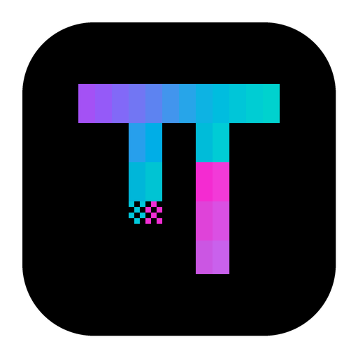

<div align="center">



# OMP Desktop source

[Project README](../README.md) ·
[Download](https://github.com/MisterBowie/omp-desktop/releases/latest) ·
[Documentation](docs/spec/README.md) ·
[简体中文](README.zh-CN.md)

</div>

This directory holds the source of OMP Desktop, a desktop app for the
[Oh My Pi](https://github.com/can1357/oh-my-pi) (OMP) coding agent. Features,
installation, and data handling are described in the
[project README](../README.md).

> **Current release line: 0.1.x.**

## Architecture

```text
Renderer (React) → Preload IPC → Electron main ─┬─ Rust host core (persistence, credentials, host tools)
                                                └─ OMP runtime (`omp --mode rpc-ui` child process)
```

- Agent execution happens in the bundled OMP runtime, a separate process. The
  desktop drives it through OMP's RPC protocol and maps its structured events to
  the UI; it never parses terminal output.
- Tool permissions are decided before a tool runs, by a trusted extension loaded
  into the runtime.
- SQLite is owned only by the Rust host core. The renderer never touches it.
- OMP-specific behavior stays in the adapter layer: `packages/omp-runtime` and
  `apps/desktop/electron/main/runtime/`.

The design decisions are recorded as ADRs in [`docs/adr`](docs/adr/README.md),
starting at [0300](docs/adr/0300-engine-boundary.md) for the OMP engine.

## Layout

| Path | Contents |
| --- | --- |
| `apps/desktop/` | Electron app: main process, preload, React renderer, and `node --test` suites |
| `crates/host-core/` | Rust host: persistence, encrypted credentials, and host tools (binary `pi-desktop-host-core`) |
| `packages/omp-runtime/` | OMP runtime supervisor, RPC adapter, tool permission extension, and plugin marketplace |
| `packages/shared/` | IPC and protocol contracts, error codes, and the in-app changelog |
| `packages/i18n/` | UI strings in eight languages |
| `packages/host-runtime/`, `packages/agent-host/`, `packages/racp/` | Transports, turn lifecycle, and the remote control protocol |
| `packages/plugin-sdk/`, `packages/plugin-devkit/` | Desktop plugin SDK and CLI |
| `apps/pi-host/`, `packages/agent-runtime/` | Pi engine code kept from PI-Desktop; not used by OMP chats and not shipped as a separate download |
| `patches/oh-my-pi/` | Manifest of the controlled OMP fork the app bundles |
| `docs/` | Specs, ADRs, and guides, in English and Simplified Chinese |
| `scripts/` | Build, release, verification, and E2E scripts |

Internal package names keep the `@pi-desktop/` scope inherited from PI-Desktop.

## Develop

Requirements:

- Node.js 24 (22.19 or newer) and pnpm 10
- Rust stable
- To build the bundled OMP runtime: Bun 1.4 or newer, Rust
  `nightly-2026-08-12`, and a checkout of
  [MisterBowie/oh-my-pi](https://github.com/MisterBowie/oh-my-pi) at the commit
  pinned in [`patches/oh-my-pi/manifest.json`](patches/oh-my-pi/manifest.json)

```bash
pnpm install
pnpm build:js
cargo build -p host-core --locked
```

### Run

```bash
pnpm dev
```

The development app uses its own data folder (`~/.omp-desktop-dev`), so it can
run next to an installed copy. OMP chats need a runtime: set
`OMP_DESKTOP_RUNTIME` to an `omp` executable, or let the app find the launcher
in the pinned `upstream/oh-my-pi` reference checkout. On macOS the development
app is a renamed Electron bundle under `.cache/electron-dev/`, and like a
packaged build it accepts only a verified runtime in its own
`Contents/Resources/omp-runtime/`. Build one with
`OMP_SIDECAR_SOURCE=/path/to/oh-my-pi node scripts/omp-sidecar.mjs --build`,
which writes `apps/desktop/resources/omp-runtime/`, and copy that folder into
the bundle ([ADR 0307](docs/adr/0307-bundled-omp-sidecar.md)).

### Test

```bash
pnpm typecheck
pnpm lint
pnpm test          # JS packages, then cargo test -p host-core
```

Automated tests use local fake providers and never call a paid model. E2E
scenarios are listed in the [E2E test plan](docs/spec/06-delivery/04-e2e-test-plan.md).

### Package

```bash
OMP_SIDECAR_SOURCE=/path/to/oh-my-pi pnpm --filter @pi-desktop/desktop run dist:mac   # or dist:win, dist:linux
```

Local packages are unsigned and are written to `apps/desktop/release/`.
Packaging refuses an OMP checkout that does not match the manifest.

### Release

Releases are built by GitHub Actions from the repository root
([`release.yml`](../.github/workflows/release.yml)). A `release-check-<version>-*`
tag builds and verifies a candidate on every platform; a
`publish-v<version>-run-<id>` tag then publishes that candidate's artifacts
without rebuilding them. Bump every version surface with
`node scripts/release.mjs <version>` and confirm the release notes with
`node scripts/check-release-docs.mjs <version>`. The full procedure is in the
[release runbook](docs/spec/06-delivery/06-release-runbook.md).

## Documentation

[Specification](docs/spec/README.md) ·
[Architecture](docs/spec/02-architecture/01-architecture.md) ·
[ADRs](docs/adr/README.md) ·
[E2E test plan](docs/spec/06-delivery/04-e2e-test-plan.md) ·
[Release runbook](docs/spec/06-delivery/06-release-runbook.md) ·
[Plugin development](docs/plugin-development.md) ·
[Contributing](CONTRIBUTING.md) ·
[Security](SECURITY.md) ·
[Agent rules](AGENTS.md)

## License

Licensed under the [GNU Lesser General Public License v3.0](LICENSE). This code
is derived from [PI-Desktop](https://github.com/vastsa/PI-Desktop), whose
copyright notices are kept. The bundled OMP runtime is under the
[MIT License](https://github.com/can1357/oh-my-pi/blob/main/LICENSE).
