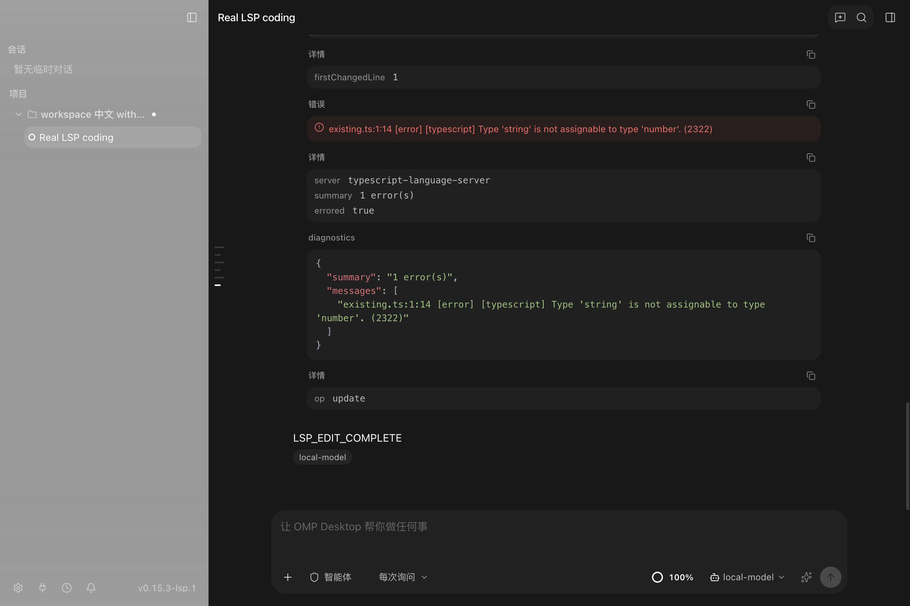

# LSP 编码路径本机专项验收（2026-10-16）

结论：当前 OMP Desktop 的编码 LSP 路径已在本机修复并完成真实安装界面验证。
`0.15.3-lsp.1` 产品源码为 `8260c37193b64ad7e2a4b99e17e6fa64b9f7723f`，
分支 `codex/lsp-coding-integration`；固定 OMP 补丁 `.6` / fork
`d648d27bcf0db16caecb876142d891cf49a51bc2`。本轮只在本机运行，未推送分支、
发布包、触发 Actions 或合并 main，未调用 DeepSeek 或其他付费模型。

## 实际缺口与修复

先检查固定 PI 实现及测试：原生 LSP 不属于其既有实现。随后读取固定 OMP 实现、测试和
实际模型工具表，确认原生 `lsp` 已作为延迟发现工具存在；工具存在不等于所有编码路径都检查。

1. OMP 默认 `lsp.diagnosticsOnWrite=true`，但 `lsp.diagnosticsOnEdit=false`。
   新写文件会检查，默认 hashline 编辑已有文件不检查。桌面运行覆盖层现开启后者。
2. 慢诊断超过原生 500ms 内联窗口后可能在 terminal `agent_end` 之后触发后台模型续跑。
   真实 TypeScript 2322 已到达后续模型请求，但桌面正确拒收已结束回合的迟到帧，因而看不到。
   `.6` 新增可选 `lsp.diagnosticsDeferred`，独立 OMP 仍默认 `true`；桌面覆盖为 `false`，
   使用原有有界、可取消的诊断流水线，在所属 Write/Edit 工具结果中完成返回。
3. 实际安装界面还复现了 Write 工具卡只显示写入内容、忽略诊断元数据的问题。
   新增失败回归后，Write 复用 Edit 的诊断展示块；成功写入仍保持成功状态，编译发现单独显示。

运行时仍由 OMP 拥有 LSP 配置发现、客户端、进程和工具。没有新增并行 LSP 服务、权限旁路、
数据库结构或自动安装行为；HOME/PATH 隔离、取消、文件版本新鲜度与进程回收保留。
详见 [ADR 0314](../../app/docs/adr/0314-omp-coding-diagnostic-settlement.md)。

## 已执行验证

| 验证 | 实际结果 |
| --- | --- |
| 原生 LSP 新鲜度、去重、批处理及失败/取消回归四套件 | 161 通过、0 失败 |
| Desktop OMP runtime 全套，实际最终包资源 | 546 通过、0 失败、0 跳过 |
| 工具呈现、原有 PI 呈现及打包来源等五个测试文件 | 81 通过、0 失败、0 跳过 |
| 最终包内严格非 Cursor Plan/Goal 契约 | 15 通过、0 失败、0 跳过 |
| 生产 runner + 审批门 + 最终二进制 + 真实 TypeScript LSP | 1 场景通过、0 跳过 |
| 实际 DMG 安装后的输入框、审批、工具卡、重启历史 | 4 项通过、2 次正常退出、最终无自有进程残留 |
| Desktop 类型检查、仓库 lint、双语文档及预览版本检查 | 通过；88 lint 文件、79 规格对、514 文档页 |
| 原生各包类型检查、三个修改文件的 oxlint/oxfmt | 通过 |

实际 LSP 服务端为 `typescript-language-server 5.0.0` + `TypeScript 5.9.3`，
明确使用 Node `24.14.0`，安装在本轮专用目录。项目根含中文、空格及引号；只通过
本机模型夹具驱动真实工具，不模拟语言服务器。Write 和默认 hashline Edit 均返回真实
2322 类型错误；`read xd://lsp` 发现工具后，`definition` 跨文件定位导入符号。
诊断同时出现在下一次模型请求和桌面工具卡；四个用户提示词恰好产生 9 个模型 POST，
没有诊断触发的额外闲时续跑。退出重开后工具诊断及导航结果保持一致，历史读取不重放工具/模型。



所有证据的摘要见 [acceptance.json](LSP-coding-local-20261016/acceptance.json)，
原始包内契约日志见 [plan-goal-final.tap](LSP-coding-local-20261016/plan-goal-final.tap)，
原始协议、模型请求、安装过程报告以无损 gzip 保存；完整清单见
[SHA256SUMS.txt](LSP-coding-local-20261016/SHA256SUMS.txt)。
`observed-command-summary` 表项是本轮实际命令输出的摘要，不冒充完整原始日志。

RED 证据也保留：旧 M7 二进制的延迟诊断轨迹、首个尚未固定提交的本机候选安装失败报告、
以及对应模型请求。原生新增慢诊断回归先出现 1 通过/1 失败，再修复为通过；
Write 展示新增回归先得到空错误块，再修复为可见 2322。未删除失败轨迹，也未放宽诊断或终态断言。

## 本机产物与使用前提

安装包：`app/apps/desktop/release/OMP-Desktop-0.15.3-lsp.1-arm64.dmg`，
223,825,116 字节，SHA-256：

```text
90bd95b36ba06eaba027b8c7e438aac483f2fa6047c51fddaf1a393baf466d25
```

实际包内原生 OMP SHA-256 为
`008c850b3f75c5a7682a83050cf145bc2fc63e3bee85daa00fb582857729f688`。
安装包保留在本机 release 目录，不纳入 Git；固定 fork 全部源码在
`/Users/vv/Documents/对话/omp-runtime-lsp`，原 M7 和用户默认模型工作树均未改动。

各项目仍需对应语言服务器及根标记。PATH 隔离不会直接继承 NVM 等 shell 配置，可通过
原生 `.omp/lsp.json` 明确指定解释器。自动诊断覆盖原生 Write/Edit；Bash 等外部改写应
主动查询 LSP 诊断。[使用说明](../05-user-guide.md) 给出配置示例。
不保证真实模型每次主动选择独立 `lsp` 调用，不声称安装了所有语言服务器。

本轮没有重新执行 Windows/Linux 原生 LSP 界面、真实付费模型或全部 M7 升级/日常场景；
旧公开 M7 包没有被本机产物替换。仍是未签名/未公证本机测试包。
原生仓库完整 `bun check` 发现补丁 `.5` 已存在的两处格式问题：
`packages/agent/src/agent-loop.ts` 和 `packages/agent/test/agent-loop.test.ts`；
已在未修改的旧 fork 复现，未把该完整命令写成通过，未混入无关格式修改。
